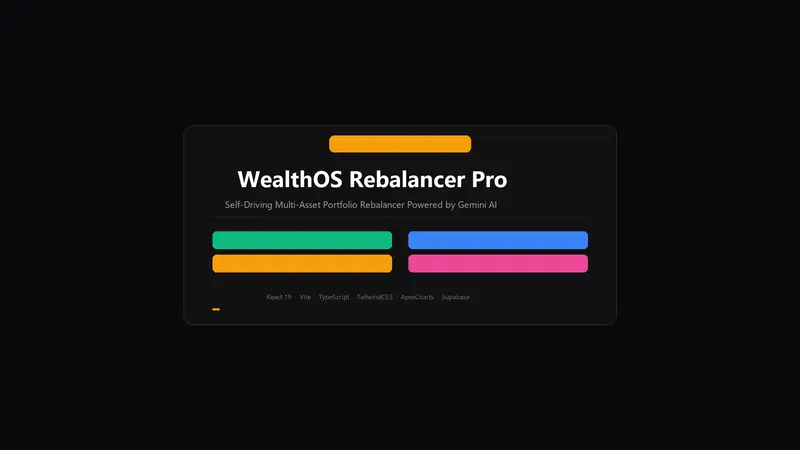
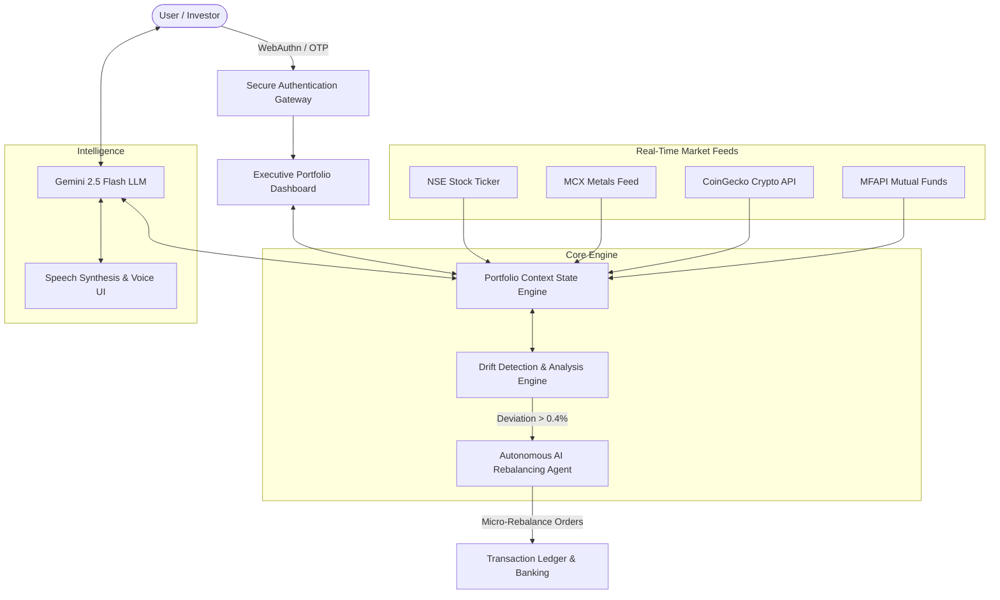

# ⚡ WealthOS Rebalancer Pro
### *Autonomous Multi-Asset Portfolio Rebalancer Powered by Gemini AI*

[](https://opensource.org/licenses/MIT)
[](https://react.dev)
[](https://www.typescriptlang.org/)
[](https://vitejs.dev/)
[](https://tailwindcss.com/)
[](https://ai.google.dev/)

---

## 🎬 Project Demo Videos

### 🎙️ 1. Full 5-Minute Technical Demonstration (Indian Voiceover Narration)
A comprehensive **5.7-minute (344 seconds)** technical deep dive and module-by-module walkthrough narrated in an authoritative **Indian English voiceover** (`en-IN`), complete with synchronized live on-screen subtitles and HUD metrics.

- 🎥 **Watch Full HD 1080p Video**: [**Play / Download docs/demo_5min.mp4**](./docs/demo_5min.mp4) *(17.2 MB, H.264 / AAC)*
- ⏱️ **Duration**: **5 Minutes 44 Seconds**
- 🎙️ **Narration**: Indian English Voiceover (`en-IN-PrabhatNeural`)
- 📋 **Synchronized Subtitles**: Included on all 10 modules

---

### ⚡ 2. Short Quick-Look Demo (22-Second Autoplay)
A concise, fast-paced overview of the live application:



> 📹 **Download Short Video**: [docs/demo.mp4](./docs/demo.mp4) (Length: ~22 seconds)

---

## 🌟 Key Highlights & Capabilities

WealthOS Rebalancer Pro is an intelligent, self-driving wealth management system engineered to automate portfolio asset allocation across global and Indian markets.

- 🤖 **Autonomous Agentic Loop**: Continuous background drift monitoring running every 25 seconds with an algorithmic tolerance threshold of ±0.4%.
- 📊 **16 Real-Time Live Assets**:
  - **Metals**: 24K Gold & Fine Silver (MCX Live Spot Feeds).
  - **Indian Equities**: Reliance, TCS, Infosys, HDFC Bank, ICICI Bank (NSE Live).
  - **Mutual Funds**: SBI Bluechip, HDFC Index Nifty 50, ICICI Pru Bluechip, Nippon India Growth (MFAPI NAVs).
  - **Cryptocurrencies**: Bitcoin (BTC), Ethereum (ETH), Solana (SOL), Ripple (XRP), Cardano (ADA) (CoinGecko Live API).
- 🧠 **Gemini AI Financial Intelligence**: Conversational assistant with natural language understanding, voice input/output, real-time risk assessment, and portfolio optimization tips.
- ⚡ **Zero-Drift Execution**: Micro-rebalancing logic dynamically deploys capital to under-allocated assets, minimizing tax drag and maximizing risk-adjusted alpha.
- 💳 **Banking Ledger & UPI Settlement**: Integrated transaction audit trail, instant QR code pay/receive, and biometric authentication (WebAuthn / Passkeys).

---

## 🏛️ System Architecture



---

## 📱 Core Modules Showcase

| Module | Description | Key Capabilities |
| :--- | :--- | :--- |
| **01. Executive Dashboard** | Real-time Net Worth & Allocation metrics | Net Worth calculation, live streaming ticker, 24h P&L, Drift Index gauge |
| **02. Drift Engine** | Automated allocation deviation analysis | Target vs actual matrix, ±0.4% tolerance triggers, zero-loss rebalancing |
| **03. Multi-Asset Vault** | Asset holding and distribution management | 16 assets across Metals, Indian Equities, Crypto, and Mutual Funds |
| **04. Market Watch Feed** | Live price streaming and technical charts | Sub-second price ticks, 24h high/low, volume & volatility analytics |
| **05. Gemini AI Assistant** | Autonomous conversational co-pilot | Natural language queries, voice interaction, portfolio strategy insights |
| **06. Banking & Ledger** | Settlement and authentication ledger | Immutable audit records, UPI QR code pay/receive, Passkey authentication |

Detailed screenshots of each module can be found in [docs/Module_Screenshots.md](./docs/Module_Screenshots.md).

---

## 🚀 Quick Start

### Prerequisites
- [Node.js](https://nodejs.org/) (v18 or higher)
- npm or pnpm

### Installation

1. **Clone the repository:**
   ```bash
   git clone https://github.com/kalalinandiswargoud2005/WealthOS-Protfilo-reblancer.git
   cd WealthOS-Protfilo-reblancer
   ```

2. **Install dependencies:**
   ```bash
   npm install
   ```

3. **Configure Environment Variables (Optional):**
   Create a `.env` file in the root directory:
   ```env
   VITE_GEMINI_API_KEY=your_gemini_api_key_here
   ```

4. **Launch the development server:**
   ```bash
   npm run dev
   ```
   Open [http://localhost:5173](http://localhost:5173) in your browser.

5. **Build for Production:**
   ```bash
   npm run build
   ```

---

## 🛠️ Technology Stack

- **Frontend Core**: React 19, TypeScript, Vite
- **Styling & UI**: TailwindCSS v4, Lucide Icons, Glassmorphic CSS
- **Data Visualization**: ApexCharts, React-ApexCharts
- **Artificial Intelligence**: Google Gemini API (`@google/genai`)
- **Persistence & Cloud**: Supabase Postgres Client, LocalStorage Fallbacks
- **Security**: WebAuthn / FIDO2 Biometric Authentication, Dynamic 6-digit OTP

---

## 📄 Documentation

- [System Architecture Specification](./docs/System_Architecture.md)
- [Module Screenshots & Demo](./docs/Module_Screenshots.md)
- [Software Development Life Cycle (SDLC)](./docs/SDLC_Documentation.md)
- [Project Development Guide](./docs/Project_Development_Guide.md)

---

## ⚖️ License

This project is licensed under the MIT License — see the LICENSE file for details.
