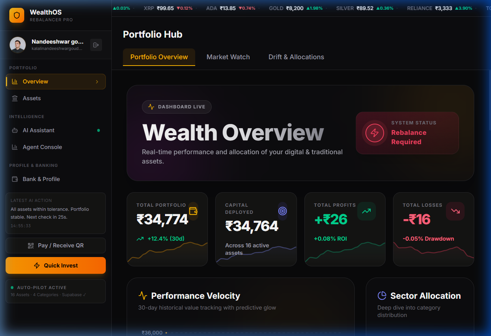
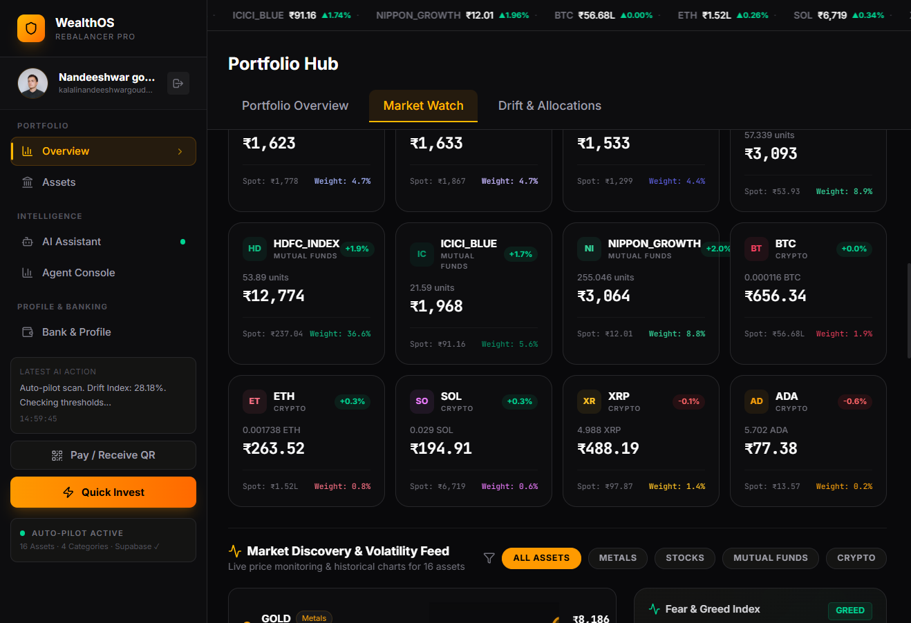
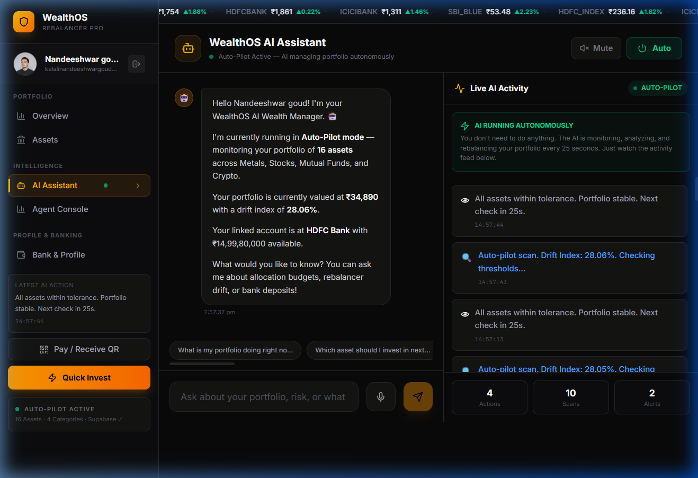
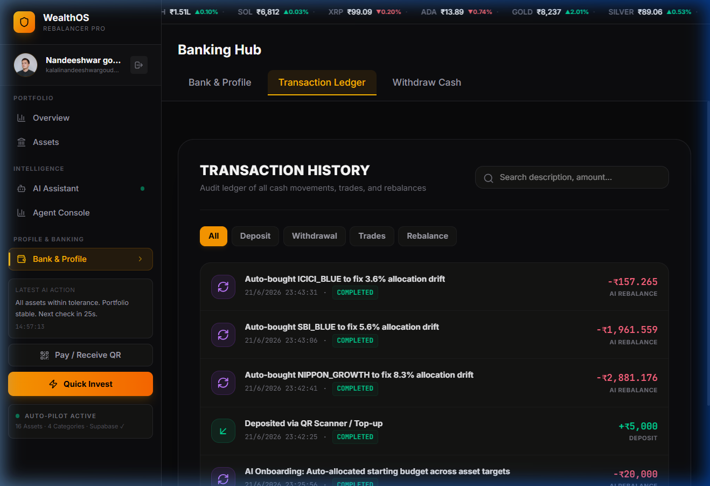

# WealthOS Pro – Module Screenshots & Live Working Demos

> [!TIP]
> **Video Demonstrations**: Two video formats are available:
> 1. **5-Minute Full Technical Walkthrough with Indian Voiceover Narration & Synchronized Subtitles**
> 2. **22-Second Short Quick-Look Autoplay Animation**

## 🎙️ 1. Full 5-Minute Technical Video (Indian Voiceover)
A complete **5.7-minute (344 seconds)** technical walkthrough covering all 10 modules, narrated in Indian English (`en-IN`) with real-time on-screen synchronized subtitles and HUD telemetry.

- 🎥 **Full HD Video Link**: [**Download / Play docs/demo_5min.mp4**](./demo_5min.mp4) *(17.2 MB, H.264 / AAC)*
- ⏱️ **Duration**: 5 Minutes 44 Seconds
- 🎙️ **Voice**: Indian English Voiceover (`en-IN-PrabhatNeural`)
- 📋 **Subtitles**: Synchronized on-screen captions

---

## ⚡ 2. Short 22-Second Autoplay Demo Video

- 📹 **Full HD 1080p Video**: [Download / Play docs/demo.mp4](./demo.mp4)
- ⚡ **Inline Autoplay Animation**: [View docs/demo.webp](./demo.webp)
- ⏱️ **Duration**: 22 seconds

---

Here are the high-resolution screenshots of the core modules captured directly from the live application running on your local machine. You can use these for your Major Project presentation and documentation.

## 1. Dashboard (Core Architecture & State Module)

## 2. Market Watch (Data Visualization Module)

## 3. AI Assistant (Gemini & Voice Integration Module)

## 4. Transactions (Payment & Authentication Module)

---
*Note: The demo video and module screenshots were captured directly from the live React application.*
